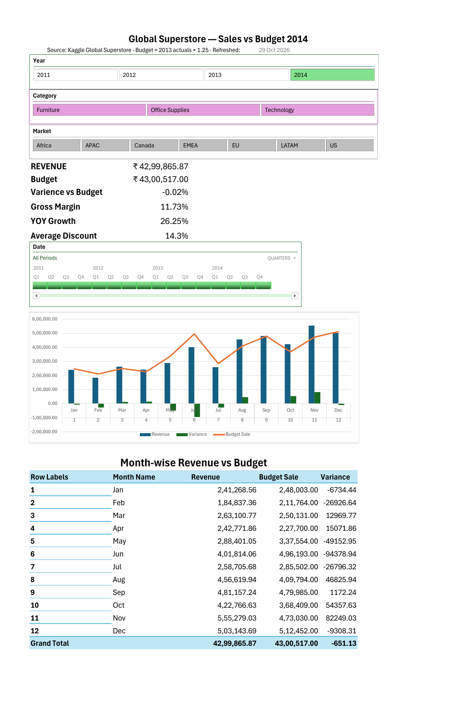

# Global Superstore — Sales vs Budget Dashboard (Excel)

An end-to-end business-intelligence workbook built entirely in Excel: Power Query ETL → Power Pivot star schema → DAX measures → slicer-driven executive dashboard. It compares 2014 sales against a regional budget for a global retailer (51K order lines, 7 markets, 13 regions, 3 product categories) and answers the question every finance team asks at month-end: *we're on budget overall — so where did we actually miss?*



---

## Headline findings (FY2014)

| | |
|---|---|
| **Company landed on plan** | Revenue $4.30M vs budget $4.30M (−0.02%), +26% YoY |
| **…but Furniture missed in 7 of 13 regions** | Worst: North Asia −30%, West −24%, Caribbean −12% |
| **Over-plan regions bought volume with margin** | Southeast Asia +14% to budget at **2.7% margin / 27% avg discount**; EMEA +14% at 7.5% margin. Southeast Asia Furniture lost money (−2.1% margin). |
| **Highest-margin regions were the biggest misses** | Canada (26% margin, 0% discount) −7%; North Asia (20% margin, 5% discount) −13% |
| **Office Supplies carried the year** | +2.2% vs budget, driven by West (+43%) and Central Asia (+57%) |

**So what:** budget attainment and pricing discipline are pulling in opposite directions. The regions hitting their numbers are doing it through discounting; the regions protecting margin are missing plan. A budget that only measures revenue is rewarding the wrong behaviour — the recommendation is a margin-weighted attainment metric.

---

## What's in the workbook

| Sheet | Purpose |
|---|---|
| `Dashboard` | One-screen executive view: 6 KPI cards, monthly actual-vs-budget chart, Region × Category variance heatmap, margin-vs-discount by region, lowest-margin sub-categories, ship-mode performance. Four global filters (Year, Category, Market, date Timeline). |
| `Analysis` | Full Region × Category × 10-measure grid used for validation and ad-hoc questions |
| *(Data Model)* | 7 tables, 7 relationships, 14 DAX measures — loaded to Power Pivot only, no data on worksheets |

### Dashboard components
- **KPI cards** use `CUBEVALUE` formulas reading the Data Model directly, so they respond to slicers without a pivot behind them
- **Variance heatmap** is a pivot with a conditional-format colour scale anchored at 0 (−30% red → 0 white → +30% green), bound to the pivot structure so it survives refresh
- **Combo chart**: revenue columns, budget line, variance bars on secondary axis
- All visuals are connected to the same four slicers/timeline

---

## Data

| Source | Rows | Notes |
|---|---|---|
| `Global_Superstore2.csv` ([Kaggle](https://www.kaggle.com/datasets/apoorvaappz/global-super-store-dataset)) | 51,290 order lines, Jan 2011 – Dec 2014 | Actuals. 24 columns. |
| `Budget_2014_wide.csv` | 54 rows × 12 month columns | Synthetic 2014 budget at Market × Region × Category grain, generated as 2013 actuals × 1.25 with seeded ±7% noise. Delivered wide (months as columns) to mirror how finance teams actually send budgets. |

The budget uplift was deliberately set so that the company lands on plan *in total* while individual region × category cells range from −33% to +70% — a realistic "fine on the surface, broken underneath" scenario.

---

## Pipeline

### 1. Power Query (ETL)
- **Actuals**: typed with `en-GB` locale (source dates are `dd-mm-yyyy` — a silent day/month swap otherwise), `Postal Code` kept as text. Added `Year / Month / Quarter / Month Name / Ship Days / Discount Band` and two composite keys.
- **Budget**: **unpivoted** the 12 month columns into a 635-row long table; derived month number from month name; built the join key.
- **Dim_Date**: generated with `List.Dates` (1,461 days) with Year / Quarter / Month / Month Name / Year-Month; `Month Name` sorted by `Month` in the model.
- **Dim_Product, Dim_Customer, Dim_Geo**: referenced from Actuals, distinct on key.
- **Dim_Budget_Key**: bridge dimension at Region × Category × Year × Month — built as the **union** of keys from Actuals and Budget so budgeted-but-unsold cells surface as −100% rather than falling into a blank bucket.
- All queries load as *connection only + Data Model* — no 51K-row sheet in the workbook.

### 2. Data model (Power Pivot)
Star schema with two fact tables sharing conformed dimensions:

```
Dim_Date ──────┬──< Actual >──── Dim_Product
               │       │
               │       ├──────── Dim_Customer
               │       │
               │       └──────── Dim_Geo
               │
               └──< Budget >──── Dim_Budget_Key >── Actual
```

- 7 active one-to-many relationships; `Dim_Date` marked as date table
- `Budget` relates to `Dim_Date` through a synthetic first-of-month `Budget Date`, so one Year slicer or Timeline filters both facts
- Fact-table attribute columns and all key columns hidden from client tools, so the field list only exposes dimension columns

### 3. DAX measures
```dax
Revenue        = SUM ( Actual[Sales] )
Gross Profit   = SUM ( Actual[Profit] )
Margin %       = DIVIDE ( [Gross Profit], [Revenue] )
Orders         = DISTINCTCOUNT ( Actual[Order ID] )
AOV            = DIVIDE ( [Revenue], [Orders] )
Units          = SUM ( Actual[Quantity] )
Avg Ship Days  = AVERAGE ( Actual[Ship Days] )
Avg Discount   = AVERAGE ( Actual[Discount] )
Revenue PY     = CALCULATE ( [Revenue], SAMEPERIODLASTYEAR ( Dim_Date[Date] ) )
YoY Growth %   = DIVIDE ( [Revenue] - [Revenue PY], [Revenue PY] )
Budget Sales   = SUM ( Budget[Budget Sales] )
Variance       = [Revenue] - [Budget Sales]
Variance %     = DIVIDE ( [Variance], [Budget Sales] )
Attainment %   = DIVIDE ( [Revenue], [Budget Sales] )
```

---

## Data-quality issues found and handled

| Issue | Impact | Fix |
|---|---|---|
| Dates stored as `dd-mm-yyyy` text | Excel's default parse silently swaps day/month for days ≤ 12 | Typed with explicit `en-GB` locale in Power Query |
| **457 Product IDs map to more than one Product Name** | A product dimension keyed on Product ID fails the uniqueness check | Composite key `Product ID \| Product Name` |
| **659 Order IDs reused across customers** | `COUNTROWS` or a naive Orders dimension would mis-count | Fact kept at line grain; `DISTINCTCOUNT` on Order ID, limitation documented |
| Budget combos with 2013 sales but no 2014 sales | Orphaned budget rows fell into a `(blank)` region | Bridge dimension built from the union of both fact tables' keys |
| Budget grain is Region × Category × Month only | Variance measures are meaningless against Sub-Category, Customer, Ship Mode etc. | Variance only ever shown beside Region / Category / time; sub-category view is actuals-only |

---

## Validation
Every stage was tied out before moving on:
- Source CSV totals (per year) = Power Query output = Data Model `Revenue` by `Dim_Date[Year]` — 2011 $2,259,451 → 2014 $4,299,866
- Unpivoted budget sums to the generator's control total ($4,300,517, 635 rows)
- Region × Category variance grid matches an independent pandas calculation on the raw files to 2 d.p.
- `Revenue PY` for 2014 = 2013 `Revenue`; 2011 PY blank

---

## Reproduce
1. Clone the repo; open `Superstore_Analysis.xlsx` (Excel 2016+ / Microsoft 365, Windows — Power Pivot required).
2. Data → Queries & Connections → edit the two file-source steps to point at your local `Global_Superstore2.csv` and `Budget_2014_wide.csv`.
3. Data → Refresh All.
4. `scripts/make_budget.py` regenerates the budget file from the actuals (`python make_budget.py Global_Superstore2.csv Budget_2014_wide.csv Budget_2014_long.csv`).

Full column dictionary and profiling notes: [`docs/DATA_NOTES.md`](docs/DATA_NOTES.md).

---

## Repo structure
```
├── Superstore_Analysis.xlsx        # the workbook (queries, model, measures, dashboard)
├── data/
│   ├── Global_Superstore2.csv      # actuals (Kaggle)
│   ├── Budget_2014_wide.csv        # budget as delivered (months as columns)
│   └── Budget_2014_long.csv        # budget answer key for the unpivot
├── scripts/
│   └── make_budget.py              # budget generator + data profiling
└── docs/
    ├── dashboard.png               # screenshot
    ├── data_model.png              # Power Pivot diagram view
    └── DATA_NOTES.md               # column dictionary, quirks, Power Query steps
```

## Skills demonstrated
Power Query (M: locale typing, unpivot, custom columns, query references, append/union) · Power Pivot (star schema, multi-fact model, date table, hidden keys) · DAX (CALCULATE, SAMEPERIODLASTYEAR, DIVIDE, DISTINCTCOUNT) · CUBEVALUE · slicers & timeline with multi-pivot report connections · pivot-bound conditional formatting · combo charts · data profiling and reconciliation in Python
